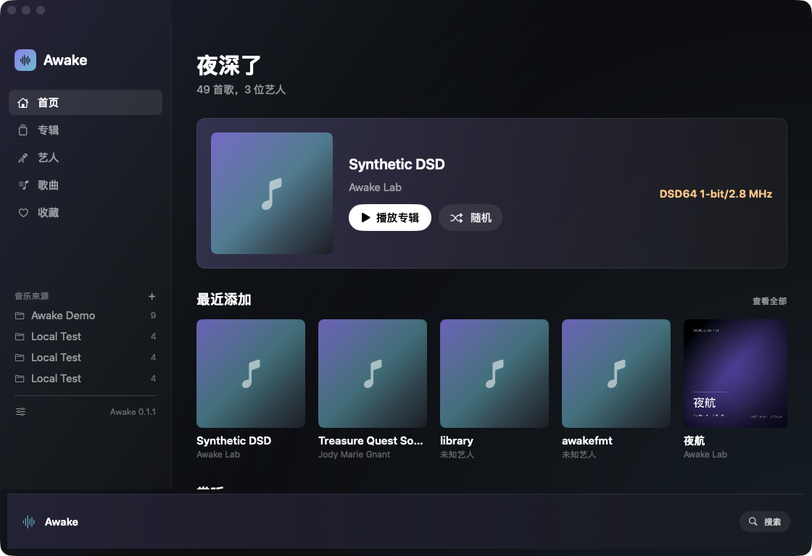
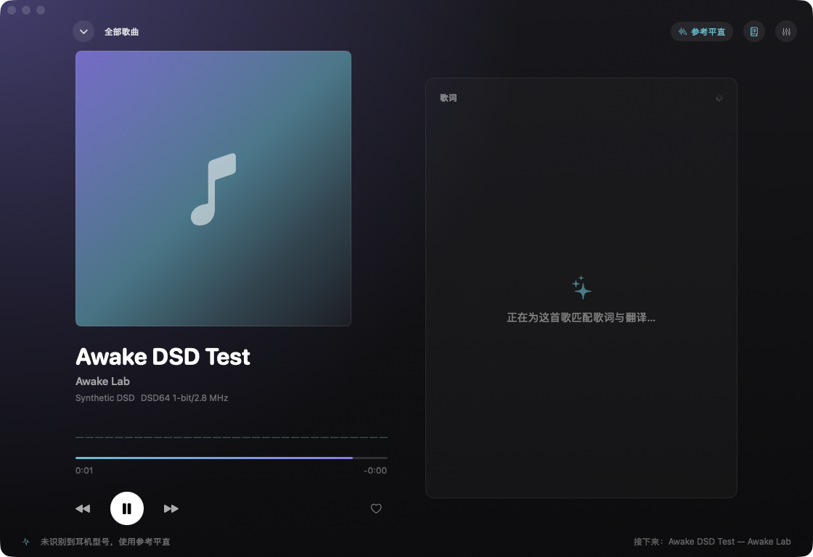
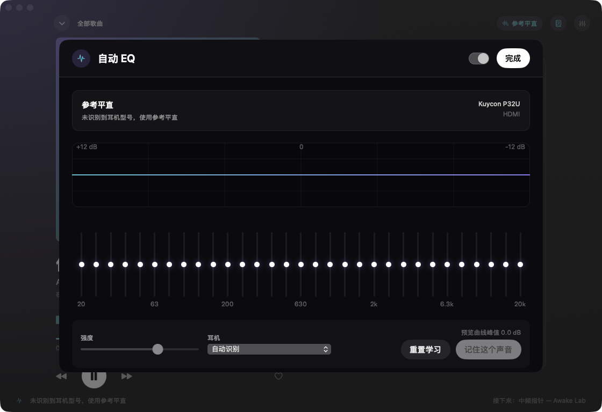
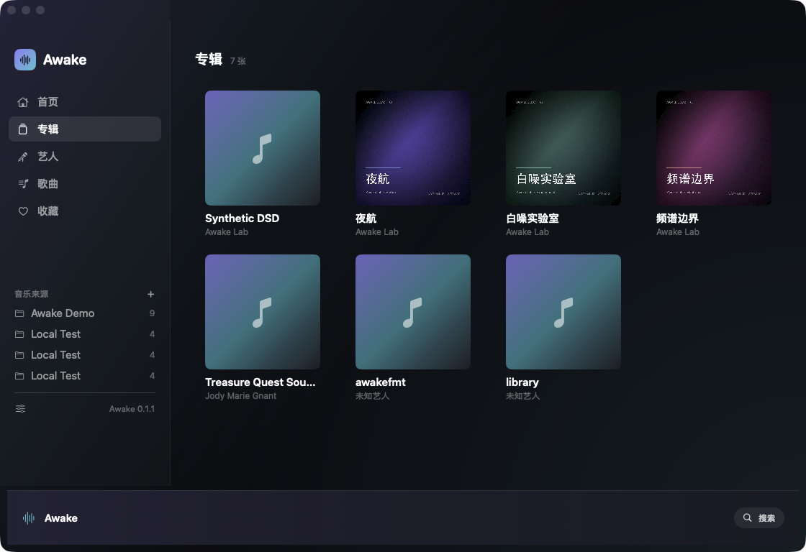
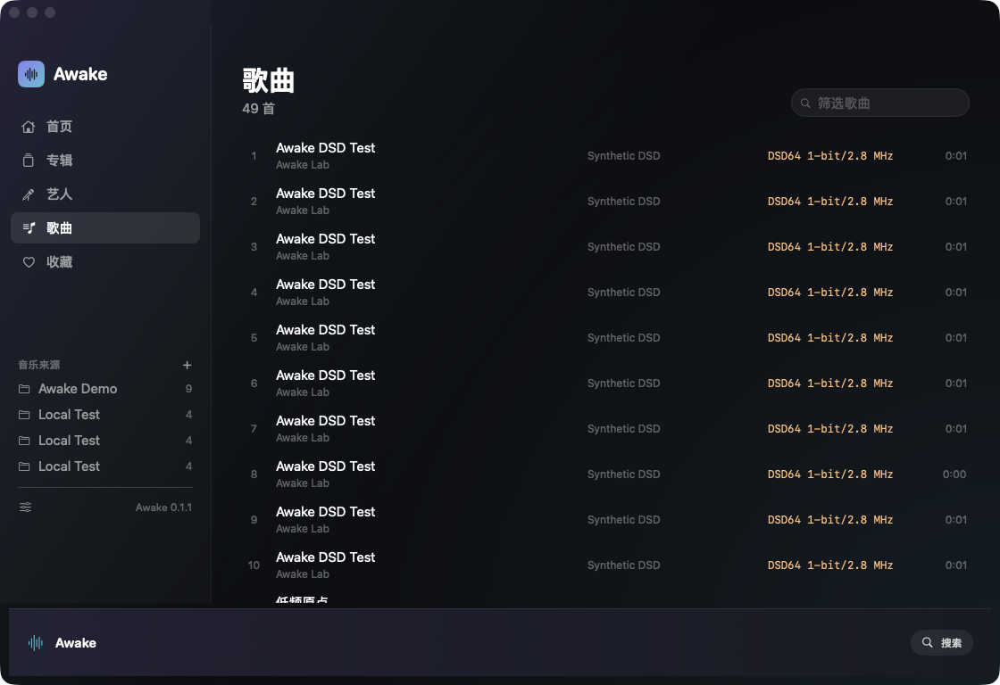
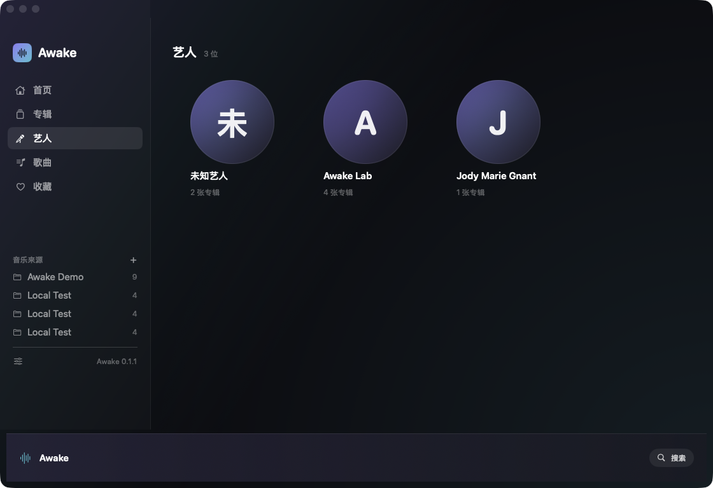
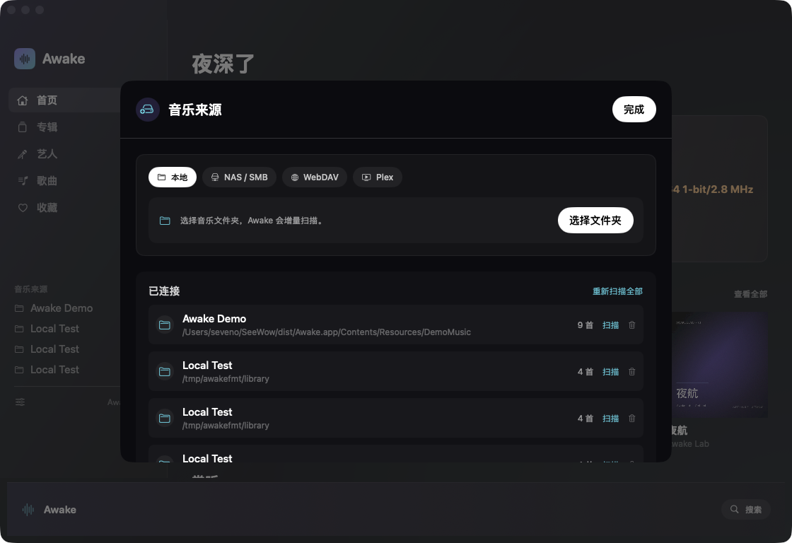
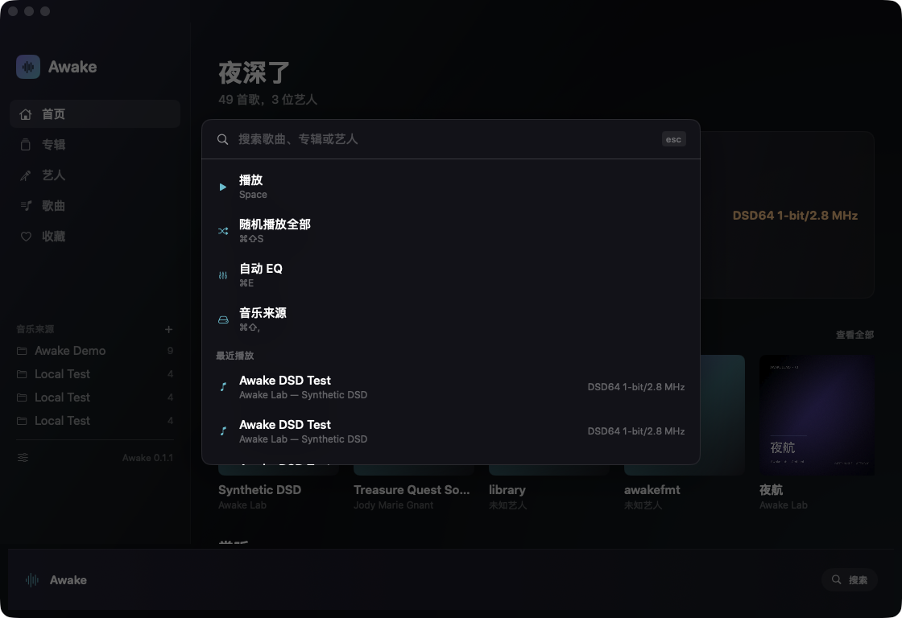
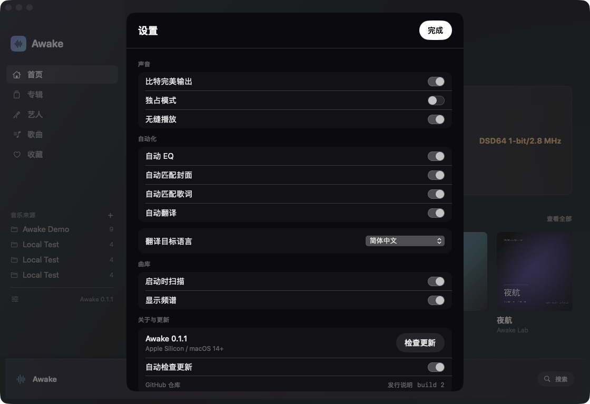
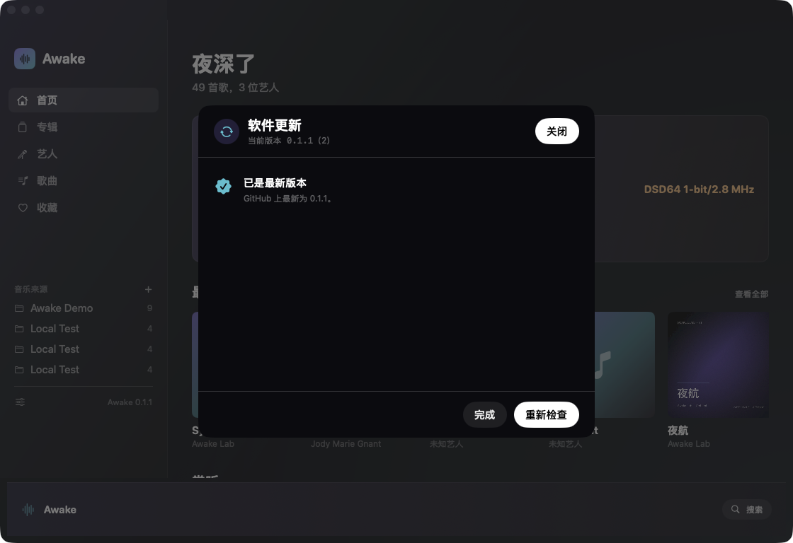

# Awake

**听深一点。** 一个为 macOS 做的高品质音乐播放器：把本地曲库、NAS、WebDAV 和 Plex 收进同一个界面，自动补封面、歌词与逐句翻译，并按当前耳机和这首曲子的频谱实时生成 EQ。没有设置向导，没有插件市场，没有「先配置一下」。



> 目标很直接：在 Mac 上做一台比 Apple Music 更懂你的播放器。v0.1 先把「声音」和「自动化」做对，剩下的在路上。

## 下载

Release 提供 `Awake-0.1.1-macos-arm64.zip`（Apple Silicon，macOS 14+，内置 9 首 24-bit / 96 kHz 演示曲库）：

```bash
curl -L -o Awake.zip https://github.com/sevenaaaaaaaaa/awake/releases/latest/download/Awake-0.1.1-macos-arm64.zip
unzip Awake.zip -d /Applications
open /Applications/Awake.app
```

也可以按下方「快速开始」从源码构建。

---

## 一分钟看懂

| | 能力 |
|---|---|
| **音质** | FLAC / ALAC / WAV / AIFF / CAF / MP3 / AAC / DSD（.dsf/.dff）/ APE；24-bit / 96 kHz 实测；按曲目切换设备采样率，可选独占（hog）模式；同格式曲目预排队实现无缝播放 |
| **EQ** | 31 段图形 EQ + 参数 EQ 导入；曲目频谱分析；12 套耳机校正曲线；按听感偏好持续学习；强度 / 余量 / 限幅全自动 |
| **曲库** | 本地文件夹、SMB / NAS、WebDAV、Plex；增量索引（size + mtime 复用），远程曲目先落本地缓存再播，保证 EQ 与无缝不被网络打断 |
| **元数据** | 内嵌标签 / 封面 → 同目录 cover / folder / front → MusicBrainz → CoverArtArchive → iTunes；歌词：内嵌 → 同名 .lrc → LRCLIB |
| **翻译** | 歌词逐句翻译（简中 / 繁中 / 英 / 日 / 韩），本地缓存，失败自动重试并保持行对齐 |
| **交互** | 歌词舞台、封面取色驱动全窗主题、32 段实时频谱、⌘K 命令面板、菜单栏与全局快捷键；双击即播，无「导入资料库」流程 |

---

## 截图

### 歌词舞台：封面、频谱、逐句译文在同一个画面里



封面主色会渗进背景与歌词高亮；每一句原文下面跟着译文；底部一行解释 AutoEQ 此刻为什么这样调。

### 自动 EQ：耳机 + 曲目 + 你的耳朵



打开就是结果，不是一堆滑杆。滑杆仍然在——想动手时随时可以接管，点「记住这个声音」后下一次会自动靠近你的偏好。

### 曲库

| 专辑 | 歌曲 |
|---|---|
|  |  |

| 艺人 | 音乐来源 |
|---|---|
|  |  |

### 命令面板与设置

| ⌘K | 设置 |
|---|---|
|  |  |

---

## 快速开始

要求：macOS 14+，Xcode 15+（本机验证于 macOS 27.3 / Swift 6.4.2）。

```bash
# 1. 构建（默认 release）
./build_awake.sh

# 2. 打开
open dist/Awake.app
```

第一次启动会自动寻找演示曲库（9 首 24-bit / 96 kHz FLAC，3 张专辑，内嵌封面与 LRC），所以不需要先接 NAS 也能听到声音。仓库不收录这 38 MB 合成音频：Release 附件里已内置；从源码构建时先跑 `./Tools/make_demo_music.sh`（需 ffmpeg）即可生成。

调试构建：

```bash
./build_awake.sh debug
./.build/debug/Awake
```

重新生成演示曲库（需要 ffmpeg）：

```bash
./Tools/make_demo_music.sh
```

---

## 原生更新与设置

Awake 不依赖 Sparkle 或安装器，直接用 GitHub Releases 做在线更新：

- **设置…（⌘,）**：App 菜单里的标准设置项，打开声音、自动化、曲库、更新四组设置。
- **检查更新…**：查询 `api.github.com/repos/sevenaaaaaaaaa/awake/releases/latest`，展示版本号与发行说明；一键下载 `Awake-*-macos-arm64.zip`，校验签名后替换 `/Applications/Awake.app` 并自动重启。
- **自动检查**：默认开启，启动时静默查询，24 小时内最多一次；发现新版本时侧边栏齿轮出现小圆点，不打断播放。
- **安全边界**：只接受 https 的 GitHub 资源；安装前核对 `CFBundleIdentifier`、版本号与 `codesign --verify --deep --strict`，任何一项不通过就中止并给出原因。



无界面自检（与 UI 同一条代码路径）：

```bash
/Applications/Awake.app/Contents/MacOS/Awake --update-check
/Applications/Awake.app/Contents/MacOS/Awake --update-install
```

---

## 接上你的音乐

侧边栏「音乐来源」→ 添加：

- **本地**：选一个文件夹，递归扫描，增量索引。
- **SMB / NAS**：填 `smb://user@host/share`（或在表单里填用户名密码）。Awake 用系统 NetFS 自动挂载，不需要先在 Finder 里连。
- **WebDAV**：填 `https://host/dav`，支持 Basic Auth；递归 PROPFIND 建库。
- **Plex**：填服务器地址与 X-Plex-Token，直接读取音乐库 section 与曲目。

凭据只写入本机钥匙串（service `com.seewow.awake`）。远程曲目播放前会缓存到 `~/Library/Application Support/Awake/cache/audio`，之后的 EQ、无缝与离线重播都走本地。

---

## 它怎么做到「不用配置」

### 1. 声音链路

```
文件 → AVAudioFile（原生采样率）
     → AVAudioPlayerNode（可预排下一首，同格式无缝）
     → 31 × AVAudioUnitEQ（AutoEQ 曲线）
     → MainMixer → 输出设备
```

- 打开曲目时读取文件真实格式，必要时把输出设备切到同一采样率（96 kHz 的曲子不会先降到 48 kHz 再升回去）。
- 设备音量优先于软件音量，尽量把增益留给系统之外。
- 独占模式开启后会 hog 设备；关闭时行为与普通 App 一致。
- 「BIT-PERFECT」徽章只在设备采样率一致且 EQ 全平的时候亮起——不拿营销词骗人。
- DSD（.dsf/.dff）与 APE 首次播放时由 ffmpeg 转成 PCM-FLAC 缓存：DSD 走 176.4 kHz / 24-bit，APE 保持原生采样率；之后直接读缓存。导入、封面、歌词、队列、自动切歌与普通 FLAC 完全同一条路径。
- 转码需要本机 ffmpeg：优先读 `AWAKE_FFMPEG`，否则找 `/opt/homebrew/bin/ffmpeg`、`/usr/local/bin/ffmpeg`、`/usr/bin/ffmpeg`。缓存按「源文件大小 + 修改时间」校验，源文件变了会自动重转。

### 2. AutoEQ 的三层叠加

```
耳机校正曲线（HeadphoneDatabase，12 套）
  + 曲目自适应（低频重 / 偏亮 / 偏暗 / 响度）
  + 你的听感偏好（ListenerProfile，逐次学习）
  × 强度（默认 0.8）
  → 31 段曲线 → 参数限幅 → preamp（含 headroom）
```

- 耳机识别来自 CoreAudio 设备名与 transport type；没识别到时退回参考平直，而不是乱调。
- 曲目分析对每首歌取 15% / 45% / 75% 三处各 6 秒做 FFT，结果按文件大小 + mtime + 采样率缓存。
- 「记住这个声音」会把当前手动曲线与自动曲线的差值写进偏好；下一次同类型曲目会更接近你。
- 支持导入 AutoEQ / Equalizer APO 的 `.txt`（PK / LS / HS / LP / HP / NO），直接换算成 31 段响应。

### 3. 元数据与歌词

封面：内嵌 → 同目录 → MusicBrainz（1.1s 限速）→ CoverArtArchive → iTunes（600×600）。
歌词：内嵌（FLAC VORBIS_COMMENT / ID3 USLT）→ 同名 `.lrc` → LRCLIB（精确 get，失败再 search 打分）。
翻译：Google 公共端点，按行对齐、1500 字符分批、失败逐行重试；结果按「原文哈希 + 目标语言」缓存在本地，二次播放不联网。

所有结果都写进 `~/Library/Application Support/Awake`，重启即用。

---

## 设计语言：Lyrics Stage

Awake 的视觉不是「深色皮肤」，而是让正在播放的专辑成为界面本身：

- **封面取色**：从 24×24 缩略图按饱和度加权取三色，驱动背景渐变、辉光、按钮与歌词高亮；换歌时整窗跟着换气。
- **歌词是主角**：进入歌词舞台后，封面、频谱、传输键退到左侧，右侧给歌词足够的行距与呼吸；当前行加粗发光，其余行降噪。
- **动效克制**：面板 0.42s spring 推入，浮层 0.18s easeOut；不做无意义的漂浮与弹跳。
- **四档字号**：12 / 15 / 20 / 32，最小 12；层级靠字重、透明度与间距建立，不在每个标题上方再挂英文小标签。
- **克制的形状**：圆角只用 8（媒体与行）与 12（面板），不叠加装饰性阴影；信息结构优先于装饰。
- **不打断**：双击歌曲即播；⌘K 输入即搜；没有「请先创建资料库」。

---

## 代码地图

```
Sources/
├── AwakeCore/                    # 与 UI 解耦的内核，可单测
│   ├── Audio/                    # AudioEngine、31 段 EQ、频谱、设备控制
│   ├── AutoEQ/                   # 耳机库、参数 EQ、曲目分析、决策引擎、偏好学习
│   ├── Library/                  # 扫描、标签解析、增量索引、远程流解析
│   ├── Metadata/                 # LRC、LRCLIB、翻译、封面链路、MetadataHub
│   ├── Models/                   # Track / Album / MediaSource
│   ├── Providers/                # Local / SMB / WebDAV / Plex
│   ├── Store/                    # 设置持久化
│   └── Update/                   # GitHub Releases 检查、下载、签名校验、替换安装
├── Awake/                        # SwiftUI 应用
│   ├── AppModel.swift            # 队列、播放、元数据、AutoEQ 编排
│   ├── RootView / LibraryViews   # 首页、专辑、艺人、歌曲、收藏
│   ├── NowPlayingView            # 歌词舞台
│   ├── EQPanel / AppSheets       # AutoEQ、来源、设置、⌘K
│   └── Theme.swift               # 颜色、封面取色、材质
└── AwakeTests/                   # 18 个单元测试
```

数据目录：

```
~/Library/Application Support/Awake/
├── library.json          # 曲库索引
├── settings.json         # 设置
├── autoeq.json           # 听感偏好
└── cache/
    ├── artwork/          # 取回/提取的封面
    ├── lyrics/           # 歌词
    ├── translation/      # 逐句翻译
    ├── analysis/         # 曲目频谱
    └── audio/            # 远程曲目缓存
```

---

## 开发与验证

```bash
swift build --product Awake     # 编译
swift test                      # 18 个单元测试（标签、LRC、翻译、元数据、WebDAV 解析）
./build_awake.sh debug          # 打包 dist/Awake.app
python3 Tools/webdav_test_server.py DemoMusic 8765   # 本地 WebDAV 回归（可选）
AWAKE_DAV_URL=http://127.0.0.1:8765/dav swift test --filter WebDAVTests
```

调试路由（截图 / 自动化用）：

```bash
./.build/debug/Awake --autoplay            # 自动播放第一首并进入歌词舞台
./.build/debug/Awake --autoplay --eq       # 再打开自动 EQ
./.build/debug/Awake --page albums         # 直接进专辑页（songs / artists / favorites）
./.build/debug/Awake --palette             # 打开 ⌘K 面板
./.build/debug/Awake --sources             # 打开音乐来源
./.build/debug/Awake --settings            # 打开设置
./.build/debug/Awake --webdav http://127.0.0.1:8765/dav   # 索引一个 WebDAV 源并验证远程取回
```

---

## 已知边界 / 下一步

这一版是 **v0.1**。能做和不能做都写在这里：

- **格式**：AVFoundation 原生格式（FLAC / ALAC / WAV / AIFF / CAF / MP3 / AAC）直接播放；DSD（.dsf / .dff）与 APE 首次播放时经 ffmpeg 转 PCM-FLAC 缓存。DSD 是转成 176.4 kHz PCM 后播放，不是原生 DSD 直出；DST 压缩的 .dff 暂不支持（未压缩 .dff 会先重封装成 DSF）。
- **WebDAV**：已用本地 WebDAV 服务做过端到端验收（递归 PROPFIND、Basic Auth、远程曲目落缓存）；远程曲目只按文件名建条目，标签/时长/封面要等首次取回后才有完整值。
- **Plex / SMB**：代码路径完整，但还没有对着真实服务器做过端到端验收；SMB 依赖系统挂载权限。
- **翻译**：走公共端点，不需要 key；网络不可用时只显示原文，不影响播放。
- **EQ 与 bit-perfect**：EQ 非全平时输出不是 bit-perfect，这是物理事实；徽章会如实熄灭。
- **平台**：目前只做 macOS。iOS / tvOS、AirPlay 2 多房间、云同步、离线下载都在路线图上。
- **测试**：内核单测覆盖标签解析、LRC、翻译与元数据；UI 与真实音频输出仍以人工验收为主。

---

## 最后一句话

Apple Music 赢在曲库和生态。Awake 不打算在那两条赛道上正面撞墙——它把赌注押在**你自己的音乐**上：你的文件、你的耳机、你的听感。把这三件事做到不用想，就有存在的理由。

v0.1 · 先让声音对，再让一切顺手。
